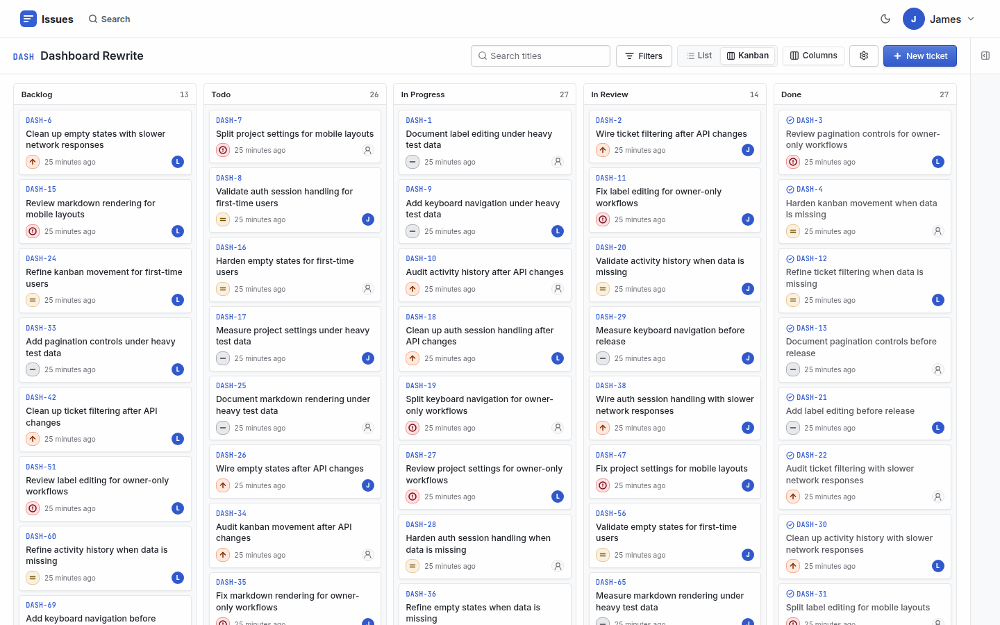

# Issues

A self-hosted issue tracker for personal projects. It has a kanban board, full-text search and an MCP server, so an AI agent can read and update tickets too.

I built it to learn, and to own my data, my schema and the design. It is not trying to replace Linear or GitHub Issues.



## Features

- **Board and list:** drag tickets between statuses on a kanban board, or sort and page through them in a list.
- **Tickets:** markdown descriptions and comments, labels, priorities, assignees, subtickets, links between tickets, attachments and cloning.
- **Search:** full-text search across every project you can see, with filters for status, priority, label, assignee and visibility.
- **Activity:** every change to a ticket is logged, field by field, and shows up in feeds for the ticket, the project and the home page.
- **Visibility:** projects and tickets can be public or private.
- **Trash:** deleted tickets can be restored, or deleted for good.
- **MCP server:** 23 tools that let an agent search, create and update tickets.

## Stack

- pnpm workspaces: `apps/api`, `apps/web`, `apps/mcp` and `packages/shared`
- Hono, Zod and TypeScript for the API, with Hono RPC for typed calls from the web app
- SvelteKit (Svelte 5) with plain scoped CSS
- PostgreSQL 16 with Drizzle ORM
- Auth with argon2, a sessions table and HTTP-only cookies
- Vitest for tests, in Node and in a real browser
- Husky and lint-staged for the pre-commit hook

## Getting started

You need Node 26, pnpm 11 and Docker.

```bash
pnpm install
```

```bash
cp apps/api/.env.example apps/api/.env
```

```bash
cp apps/web/.env.example apps/web/.env
```

```bash
docker compose up -d db
```

```bash
pnpm db:reset
```

```bash
pnpm dev
```

The web app runs at <http://localhost:5173> and the API at <http://localhost:4000>. Sign in with `james@test.com` and `password123`.

Postgres runs on port 5436. On its first start, the container creates `issues_dev`, `issues_test` and `issues_test_e2e`.

Without the seed, the first person to register is the only account. Registration closes after that.

## Commands

Run these from the repo root.

| Command                                | Purpose                                                 |
| -------------------------------------- | ------------------------------------------------------- |
| `pnpm dev`                             | Run the API and the web app                             |
| `pnpm build`                           | Build every package                                     |
| `pnpm typecheck`                       | Type check every package                                |
| `pnpm lint`                            | Run ESLint                                              |
| `pnpm format` / `pnpm format:check`    | Fix or check formatting and lint                        |
| `pnpm test`                            | Run the unit and integration tests                      |
| `pnpm test:unit`                       | Run the fast tests, which the pre-commit hook also runs |
| `pnpm test:integration`                | Run the API tests against a real database               |
| `pnpm coverage`                        | Run every test with a coverage report                   |
| `pnpm db:generate` / `pnpm db:migrate` | Create a migration from the schema, or apply migrations |
| `pnpm db:seed`                         | Empty the database and add demo data                    |
| `pnpm db:wipe`                         | Empty every table                                       |
| `pnpm db:reset`                        | Migrate, wipe and seed                                  |

`db:seed`, `db:wipe` and `db:reset` delete data. They refuse to run unless the database is on this machine and its name ends in `_dev`, `_test` or `_test_e2e`.

The integration tests run in parallel. Each worker gets its own copy of `issues_test`, and the run drops the copies when it ends.

## MCP server

The MCP server lets a client such as Claude Code work with your tickets. It talks to the API with a bearer token.

1. Create a service user and a token on the settings page. Tokens can only be created from a signed-in session, so a leaked token can't make more.
2. Build the server:

   ```bash
   pnpm --filter @issues/mcp build
   ```

3. Add it to your client's MCP config:

   ```json
   {
     "mcpServers": {
       "issues": {
         "command": "node",
         "args": ["/path/to/issues/apps/mcp/dist/index.js"],
         "env": {
           "ISSUES_API_URL": "http://localhost:4000",
           "ISSUES_API_TOKEN": "<your token>"
         }
       }
     }
   }
   ```

## Deployment

`deploy.yaml` and the `Jenkinsfile` build the `issues-api` and `issues-web` images and deploy them with `docker-compose.yml`. Traefik sits in front, sends `/api` and `/uploads` to the API, and sends everything else to the web app.

The API runs as a bundled JavaScript file and applies migrations when it starts.
